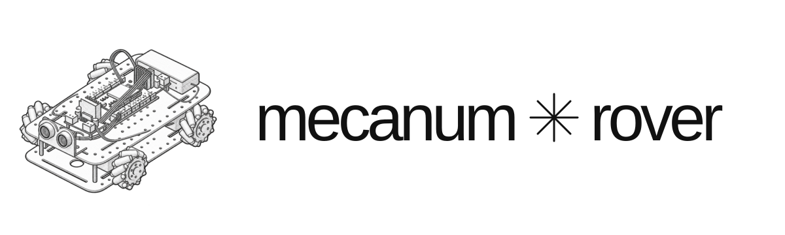

<div align="center">
  <p></p>
  <p><a href="https://mecanum-rover-website.vercel.app">Website</a></p>
</div>

##  Prerequisites

The assembled rover uses an ESP32-S3 with 16 MB flash and OPI PSRAM (external memory), two L298N motor drivers and a front-facing HC-SR04 (ultrasonic distance sensor). Install Arduino IDE 2 and **esp32 by Espressif Systems, version 3.3.11** through Boards Manager; no additional libraries are required.

Add this address under **Preferences → Additional Boards Manager URLs**:

```text
https://raw.githubusercontent.com/espressif/arduino-esp32/gh-pages/package_esp32_index.json
```

##  Installation

1. Open [`RC_Car_intelligent_avoidance.ino`](sketches/RC_Car_intelligent_avoidance/RC_Car_intelligent_avoidance.ino) in Arduino IDE.

2. Select **ESP32S3 Dev Module**, **Flash Size: 16MB**, **PSRAM: OPI PSRAM**, **USB Mode: Hardware CDC and JTAG**, and **USB CDC On Boot: Enabled**.

3. Connect the board by USB, select its port and click **Upload**, with motor power switched off.

4. Check the wiring against the sketch's pin assignments, lift the wheels for the first run, then enable the battery supply. The program starts automatically; switch off motor power to stop movement.

Cheers,
